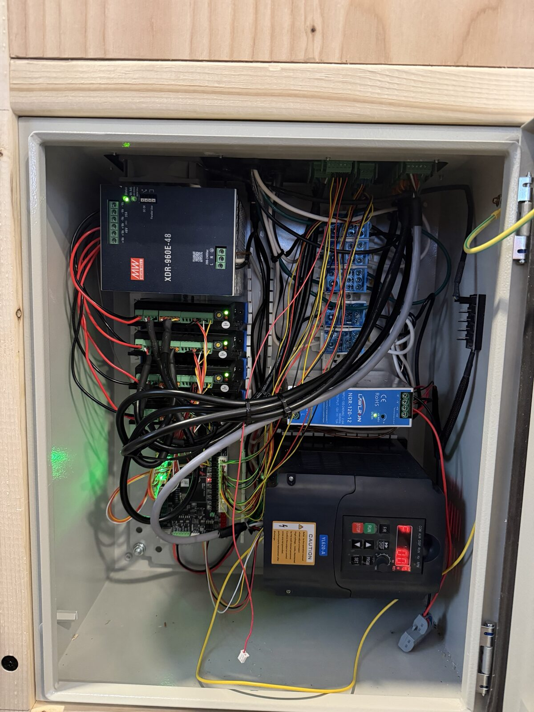
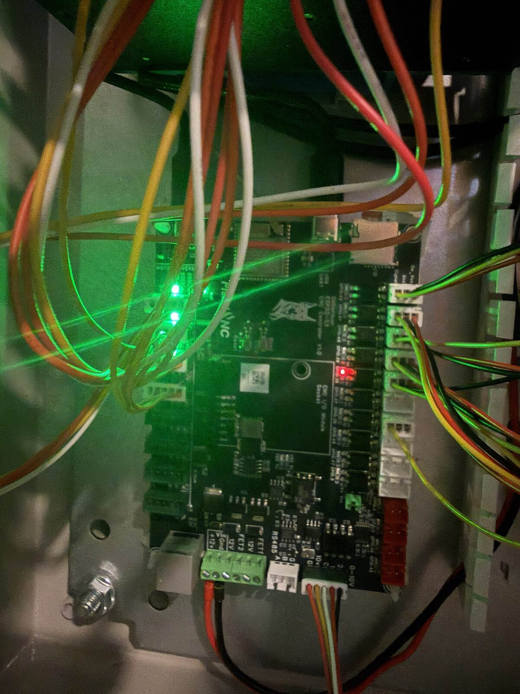
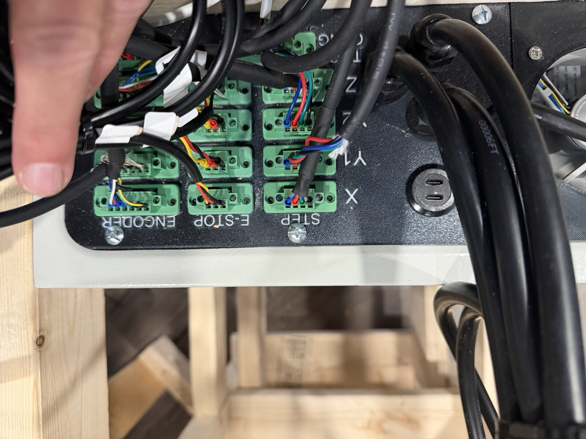
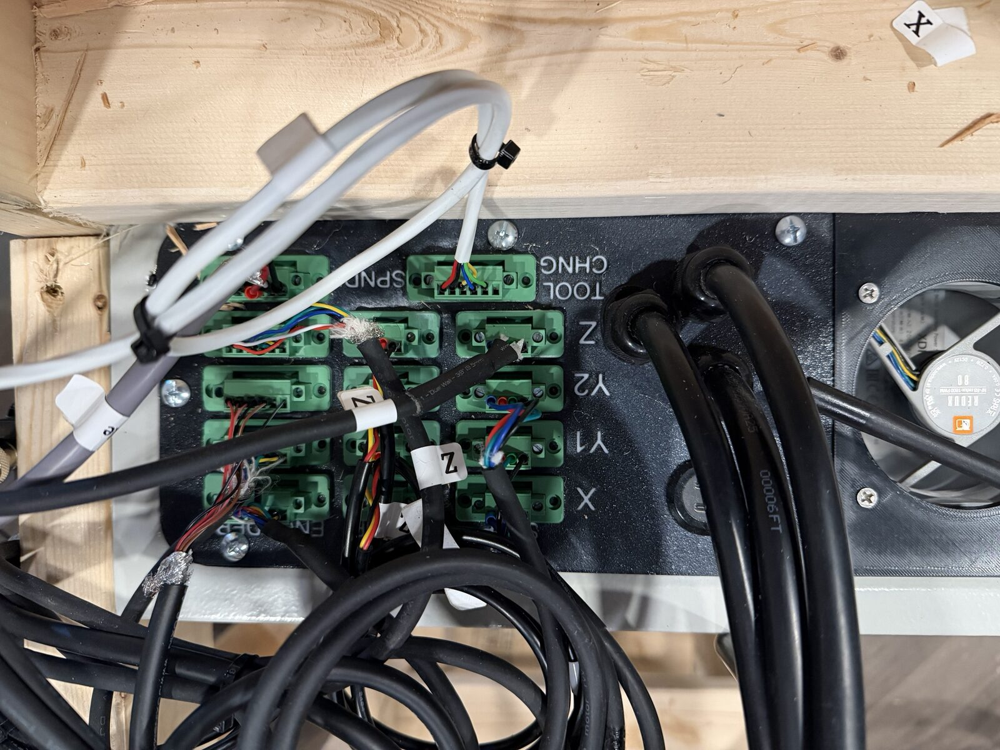
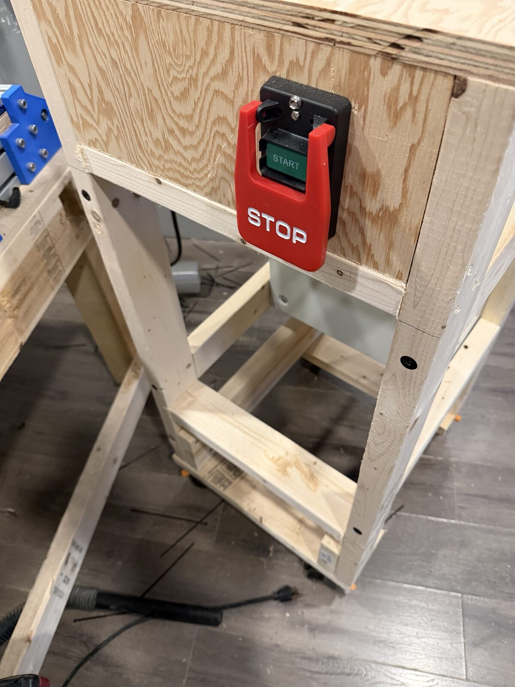

# Wiring and pin assignments

## Doberman input pins — the thing to know first

GPIO 36–42 are **opto-isolated inputs with onboard pull-ups**. Consequences:

- Never add `:pu` or `:pd` — the pull-up is already on the board
- NPN-NO sensors use `:low`
- These pins **cannot be used as outputs**. The GPIO sits behind a phototransistor
  and can only read. Configuring one as an output throws no error and does nothing.
- A `Switch Vcc` jumper selects 5 V or Vin (12 V) for *all* inputs together
- The PCB LED lights when an input is pulled low

This board is set to **5 V**, because the tool changer's sensors need 5 V.

## Endstops

ROURCK SN04-N inductive, NPN-NO, running at **5 V**.
Brown to +5 V, blue to 0 V, black to the input pin.

The `Switch Vcc` jumper is global, and the tool changer's sensors need 5 V, so
the endstops run at 5 V too — there is no way to have one at 5 V and the other
at 12 V from the board.

These SN04-N are specified 5–30 V DC, so 5 V is in spec but at the very bottom
of the range. They work reliably. If endstops ever start behaving erratically,
supply voltage is worth ruling out early rather than late.

| Axis | Pin | Config |
|---|---|---|
| X | gpio.42 | `limit_pos_pin: gpio.42:low` |
| Y1 | gpio.41 | `limit_pos_pin: gpio.41:low` |
| Y2 | gpio.40 | `limit_pos_pin: gpio.40:low` |
| Z | gpio.39 | `limit_pos_pin: gpio.39:low` — Z homes up |

All three axes home positive: X to the right-hand switch (facing the front), Y to
the back, Z to the top. All home to `mpos_mm: 0`, so after `$H` the machine reads
0, 0, 0 at the switches and the working envelope is X 0 to −1220, Y 0 to −1200,
Z 0 to −115. Facing the front, +X is right, +Y is away, +Z is up — the CAM
convention. X and Y were both flipped on 2026-10-19; before that they homed
negative and CAM output came out wrong (see troubleshooting).

## Spindle — 0-10 V module

| Signal | Pin |
|---|---|
| Analog out | gpio.6 |
| Forward | gpio.7 |
| Reverse | gpio.8 |

The Doberman 0-10 V module labels its terminals **VI** (signal), **Grn** (analog
common), **Out1** (= FWD), **Out2** (= REV) and **Com** (digital common) rather
than the generic names. The YL620-A has no terminal marked plain `COM` — digital
common is **XGND** and analog common is a separate **GND**.

The module's trim pot is set to 10.13 V measured under load, which gives 392 Hz at
a commanded S24000.

## Tool changer — 5-wire harness

| Wire | Function | Pin |
|---|---|---|
| Red | 5 V | input header Vcc |
| Black | Ground | input header GND |
| Green | Tool setter | gpio.36, `probe: pin: gpio.36:low` |
| Yellow | IR beam | gpio.38, `user_inputs: digital0_pin: gpio.38:low` |
| Blue | Dust cover | see below — not currently connected |

IR beam reads **1 when clear, 0 when blocked**, verified on the machine.
The macros read it with `M66 P0 L0` into `#5399`.

## The hardware



Cabinet, top left to bottom right: Meanwell XDR-960E-48 (48 V, 20 A) for the
motors, the CL57T closed-loop drivers below it, Lawlron NDR-120-12 (12 V, 10 A)
for logic, and the YL620-A VFD across the bottom. The Doberman sits to the left
of the VFD.





Machine-side connections land on a breakout panel rather than at the board
directly. STEP per axis (X, Y1, Y2, Z), E-STOP, and ENCODER for the CL57T
closed-loop feedback.



The other half carries SPNDL and TOOL CHNG — the 5-wire magazine harness lands
on that one.

## Emergency stop



Hardwired paddle switch on the front of the table. It **cuts power to the
moving parts — motors and spindle — and deliberately leaves the Doberman
powered.**

Keeping the controller alive is the right call. The WebUI stays up, the config
stays loaded, and `current_tool` is not reset to −1, so you are not re-doing
`M61` on top of everything else.

**But it means FluidNC does not know the E-stop happened.** The controller keeps
its own idea of position while the motors are dead, so after an E-stop the
displayed MPos is stale and looks perfectly normal. Nothing alarms and nothing
forces a re-home.

**Always `$H` after an E-stop**, before any move. Treat the position on screen
as fiction until you have.

### Worth wiring: tell the controller

FluidNC has two control inputs for exactly this, both of which do an immediate
hard stop plus a critical alarm that only a soft reset clears, and which block
homing and unlock until then:

```yaml
control:
  fault_pin: gpio.37:low   # all four CL57T ALM outputs, ganged
  estop_pin: gpio.XX       # a spare contact on the E-stop switch
```

**gpio.37 is the pin to use.** It is a free opto input — it carried the dust
cover wire before that was abandoned — and it sits in the same header block as
the limit switches, so the wiring lands next to everything else.

### The opto-isolated input block — ten pins, four free

Read off the silkscreen, left to right:

**GPIO.42 · 41 · 40 · 39 · 38 · 37 · 36 · 48 · 47 · 3**

Ten inputs, each with its own optocoupler and 3-pin connector. The block is not
the contiguous 36-42 range it looks like — 48, 47 and 3 sit on the end.

| Pin | Used by |
|---|---|
| gpio.42 | X limit |
| gpio.41 | Y1 limit |
| gpio.40 | Y2 limit |
| gpio.39 | Z limit |
| gpio.38 | IR beam |
| **gpio.37** | **free** |
| gpio.36 | probe / tool setter |
| **gpio.48** | **free** |
| **gpio.47** | **free** |
| **gpio.3** | **free, but see below** |

So `fault_pin` and `estop_pin` can each have an isolated pin, with two spare.
Every one of them is optocoupled, has an onboard pull-up (never add `:pu`), and
takes `:low` for an NPN-NO sensor.

**gpio.3 last.** It is an ESP32-S3 strapping pin — JTAG signal source — as are
0, 45 and 46, which is why the board spends 45 and 46 on the 5 V outputs and
these on inputs. An input held active while the board boots can influence a
strapping pin, so gpio.3 suits something guaranteed inactive at power-up rather
than a fault line that may well be asserted exactly when you are restarting to
clear it.

**Suggested allocation:**

| Signal | Pin | Why |
|---|---|---|
| CL57T ALM, four ganged | gpio.37 | middle of the block, no strapping role |
| E-stop spare contact | gpio.47 or gpio.48 | clean pins, no strapping role |

Both being isolated also settles the earlier worry about the ALM: whatever
COM- turns out to be referenced to, there is an optocoupler between it and the
microcontroller.

The four 5 V outputs (gpio.4, 5, 45, 46) are behind a 74AHCT125 buffer and
cannot be read back, so they are not candidates.

### Wiring it

```
driver 1  ALM ──┐
driver 2  ALM ──┤
driver 3  ALM ──┼──────────── gpio.37  signal
driver 4  ALM ──┘

driver 1  COM- ─┐
driver 2  COM- ─┤
driver 3  COM- ─┼──────────── input header  GND
driver 4  COM- ─┘
```

Two wires per driver to a terminal block on the breakout panel, then one pair
across to the Doberman. All four ALM commoned, all four COM- commoned.

### Ganging four ALM outputs

Each driver brings out a **single ALM pin**, not a floating ALM+ / ALM- pair.
The alarm is an open-collector output returning through **COM-**, which is its
own terminal on the control connector — not the step/direction return, and not
anything already wired. It needs a wire of its own.

Two consequences follow, and both are settled by measurement rather than by
choosing an approach up front:

- **Whether a series chain is possible depends on COM-.** Measured 2026-10-23:
  COM- is **not** continuous with the driver's power GND, so the output side is
  isolated from the 48 V supply rather than referenced to it. That removes the
  ground-bonding concern entirely, and it means each driver's ALM/COM- may be
  an independently floating pair — which chains in series like a dry contact.
  Confirm with a continuity check between COM- on two different drivers, powered
  off: open means independent, continuous means parallel is the only option.
- **Whether parallel even works depends on which way the output rests.** If it
  conducts on alarm, paralleling ORs them and all is well. If it conducts when
  healthy, paralleling ANDs them and the arrangement is useless. Establish this
  on one driver before wiring four.

If it conducts on alarm, parallel is the arrangement and it **fails silent**: a
broken ALM wire or a connector knocked off removes that driver's protection with
no indication, and the input sits healthy forever. So the protection is only as
good as the last time it was tested — test it deliberately, and re-test after
any work in the cabinet.

If it conducts when healthy, and the COM- pins are independent, a series chain
gives the opposite: an open loop is itself an alarm, so a broken wire announces
itself. That is the better outcome of the two.

#### The driver's connectors

From the label on the driver itself:

| Connector | Pins |
|---|---|
| Control | PUL+, PUL-, DIR+, DIR-, ENA+, ENA-, **ALM**, **BRK**, **COM-** |
| Encoder | EA+, EA-, EB+, EB-, VCC, EGND |
| Power and motor | A+, A-, B+, B-, +Vdc, GND |

Step, direction and enable are differential pairs. **ALM and BRK are the only
single-ended signals, and COM- is their common** — the shared emitter of the two
output transistors. So the connection is:

- `ALM` to gpio.37's signal pin
- `COM-` to the input header GND

That is an open-collector NPN sinking to COM-, which is what the opto input
wants: pull the signal pin down through the onboard pull-up. Four of them
parallel wired-OR correctly, with all four COM- on the same ground.

**BRK sits next to ALM and is also an output.** It is brake release for motors
with an electromagnetic brake, and the 24E1K-30 has none, so it stays
unconnected. Worth being deliberate about: BRK asserts during *normal*
operation, so on `fault_pin` it gives either a permanent alarm or a permanently
healthy input, and both read as a config problem rather than a wiring one.

#### What COM- is tied to — measured 2026-10-23

Powered off, probing COM- against that driver's `GND` power terminal: **not
continuous.** The ALM output side is isolated from the 48 V supply rather than
referenced to it.

So connecting COM- to the input header GND ties a floating node to board
ground. Nothing is bonded, there is no ground loop to engineer around, and the
star-ground advice that used to sit here does not apply.

An earlier draft also called for measuring DC volts from COM- to board ground.
That is void twice over: the question it was asking — would this wire bond the
48 V negative to logic ground — is already answered no, and a voltmeter on a
floating node reads stray coupling rather than a potential, so it could not
have answered it anyway.

**The four COM- pins are independent — measured 2026-10-23, OL between COM- on
two drivers.** So each driver's ALM/COM- is its own floating pair: four
independent switches, which can be wired in series or in parallel exactly like
dry contacts.

Both topologies are therefore available, and the polarity decides which:

| ALM output | Topology | Config | Fail-safe? |
|---|---|---|---|
| conducts on alarm | parallel — all ALM to signal, all COM- to GND | `fault_pin: gpio.37:low` | no |
| conducts when healthy | series — signal through each driver in turn to GND | `fault_pin: gpio.37` | **yes** |

There is no wiring that makes the first row fail-safe. A contact that rests
open cannot report its own broken wire. If it turns out to conduct on alarm,
the protection is only as good as the last time it was deliberately tested.

#### Establishing which way ALM rests

This decides whether paralleling works at all, so it comes before wiring all
four.

**A meter will not tell you.** ALM is an open collector — a transistor that
either ties ALM to COM- or leaves it floating — and floating reads as no
particular voltage with nothing pulling it up. An ohmmeter on a powered circuit
is no better. The pull-up needed is the one already on gpio.37, so wire one
driver and let the firmware read it.

1. **Wire one driver only.** COM- to the input header GND, ALM to gpio.37's
   signal pin.
2. **Read it as an ordinary input, not as a fault.** Temporarily add
   `user_inputs: digital1_pin: gpio.37:low` alongside the existing IR beam on
   digital0. With the machine healthy, `M66 P1 L0` and note `#5399`.
3. **Force an alarm on that driver.** Unplug its encoder and power-cycle it —
   many closed-loop drivers fault on encoder loss with no motion at all, so
   look for the red PWR/ALM LED first. If it does not fault, command a short
   slow move on that axis. Then `M66 P1 L0` again.

| Healthy | Alarmed | Output | Consequence |
|---|---|---|---|
| 0 | 1 | Conducts on alarm | Parallel all four, `fault_pin: gpio.37:low` |
| 1 | 0 | Conducts when healthy | Series chain, `fault_pin: gpio.37` — fail-safe |

Parallel is wrong for the second row: four outputs that conduct when healthy
keep the pin held low by the three healthy drivers while the fourth faults, so
nothing fires until all four have gone. Chain them instead — gpio.37's signal
through each driver in turn and back to GND — which needs the COM- pins to be
independent, per the continuity check above. If they are commoned, that case
needs a PC817 per driver with the transistors paralleled.

Test through `user_inputs` rather than `fault_pin` because `fault_pin` raises a
*critical* alarm that only a soft reset clears, and a soft reset sets
`current_tool` back to -1. Reading it as a plain input can be repeated as often
as needed without locking the machine or re-doing `M61`.

Once the sense is known, drop the temporary `digital1_pin`, wire the remaining
three, and move gpio.37 to `control: fault_pin:` with the polarity the test
gave.

### Testing it

Two stages, because they fail differently.

1. **The input and the config.** With `fault_pin` set and the board restarted,
   short gpio.37's signal pin to GND. FluidNC should drop straight into a
   critical alarm.
2. **A real driver fault.** Unplug one motor's encoder and command a short move
   — the driver sees position error it cannot correct and asserts ALM.

A critical alarm only clears with a soft reset (Ctrl-X), and that resets
`current_tool` to −1. So after testing: `$H`, then `M61 Q<n>`.

`estop_pin` is meant for a user-operated switch; `fault_pin` is meant, in the
firmware's own words, for "a stepper driver's fault/alarm output". The CL57T
drivers have those alarm outputs and nothing is currently reading them — so a
driver that faults on position error looks exactly like lost steps.

Neither replaces cutting power. FluidNC's own comment on `estop_pin` is blunt
about it: "this alone is only a control-input-level stop; a true e-stop should
also cut power directly." The hardwired switch is the real safety function.
Adding the signal just stops the software from lying about where the machine is.

## Doberman outputs, for reference

Four 5 V outputs on red 2-pin connectors, driven by a 74AHCT125 — true push-pull
5 V, 20 mA each and 50 mA total. Left to right:

| Position | Pin | Note |
|---|---|---|
| 1st | gpio.4 | also fires MOSFET1 |
| 2nd | gpio.5 | also fires MOSFET2 |
| 3rd | gpio.46 | ESP32-S3 strapping pin |
| 4th | gpio.45 | ESP32-S3 strapping pin |

On each connector, **pin 2 is signal and pin 1 is ground**.

Two MOSFETs, 3 A continuous / 5 A peak, with flyback diodes to VMot. They switch
to ground when their GPIO is active, and VMot is always 12 V. They share gpio.4
and gpio.5 with the first two 5 V outputs, so driving those outputs fires a MOSFET
as a side effect — avoid them for logic signals if anything is attached.
